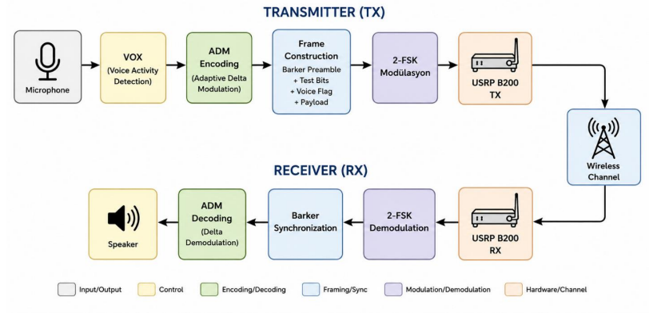

\# Digital Wireless Walkie-Talkie (SDR)

\## Overview

This project implements a real-time, half-duplex digital walkie-talkie communication system using Ettus USRP B200 Software Defined Radios (SDR). Developed in MATLAB, the system bridges theoretical communication models with practical hardware behavior by performing end-to-end baseband processing, active voice encoding, and live channel monitoring over a 2.45 GHz wireless link.

Unlike simple analog radios, this system digitizes audio into structured binary frames, proving the mathematical resilience of modern signal processing against channel noise and phase offsets.

\## System Architecture \& Key Features

\* \*\*Source Encoding (ADM):\*\* Uses Adaptive Delta Modulation to convert analog microphone input into a bandwidth-efficient 1-bit sequence, dynamically adjusting step sizes based on bit history.

\* \*\*Modulation (CPFSK):\*\* Implements Continuous-Phase 2-FSK mapping bits to +/- 35 kHz deviations, integrating phase continuously to suppress spectral leakage.

\* \*\*Demodulation:\*\* Bypasses complex carrier phase locking by utilizing a robust non-coherent phase-difference detection algorithm.

\* \*\*Synchronization:\*\* Embeds a repeated Barker-13 preamble in every frame, applying matched filtering at the receiver for precise frame-start detection.

\* \*\*Smart TX/RX Control:\*\* Integrates Voice Activity Detection (VOX) with a manual Push-To-Talk (PTT) interface. The system avoids transmitting payload during silence, dropping receiver goodput to 0 bps to protect the speaker from static noise.

\* \*\*Live Performance Metrics:\*\* Dynamically calculates and plots Bit Error Rate (BER), Signal-to-Noise Ratio (SNR), outage probability, preamble peaks, and eye diagrams simultaneously during operation.

\## Hardware \& System Specifications

| Parameter | Value |

| :--- | :--- |

| \*\*SDR Hardware\*\* | USRP B200 |

| \*\*Carrier Frequency\*\* | 2.45 GHz |

| \*\*Baseband Sample Rate\*\*| 400 kS/s |

| \*\*Bit Rate\*\* | 50 kbps |

| \*\*Audio Sample Rate\*\* | 8 kHz |

| \*\*Frame Duration\*\* | 0.05 s (2500 bits) |

| \*\*Audio Payload\*\* | 2400 bits |

\## Frame Structure

Each 0.05s transmitted frame is strictly organized as follows:

`\[ Barker Preamble (52) | Test Bits (16) | Voice Flag (32) | ADM Payload (2400) ]`

\## Prerequisites

\* MATLAB 2026A (it's not working on older version but it may work on new versions)

\* Communications Toolbox

\* Audio Toolbox

\* Communications Toolbox Support Package for USRP Radio

\## Usage

1\. Connect the USRP B200 to the host machine via USB 3.0.

2\. Run `walkie\_talkie.m` from the `/src` directory in MATLAB.

3\. Click once on the pop-up Live Metrics UI figure to bring it into focus.

4\. Hold the \*\*SPACE\*\* bar to transmit (PTT ON) and speak into the microphone. 

5\. Release the \*\*SPACE\*\* bar to return to receive mode (PTT OFF).

