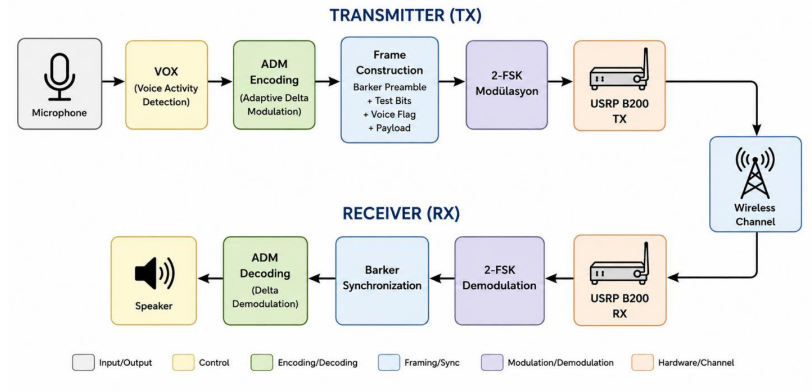
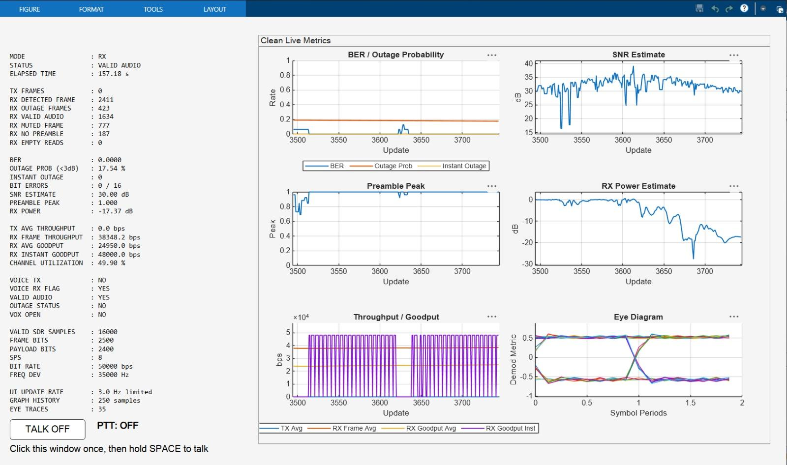
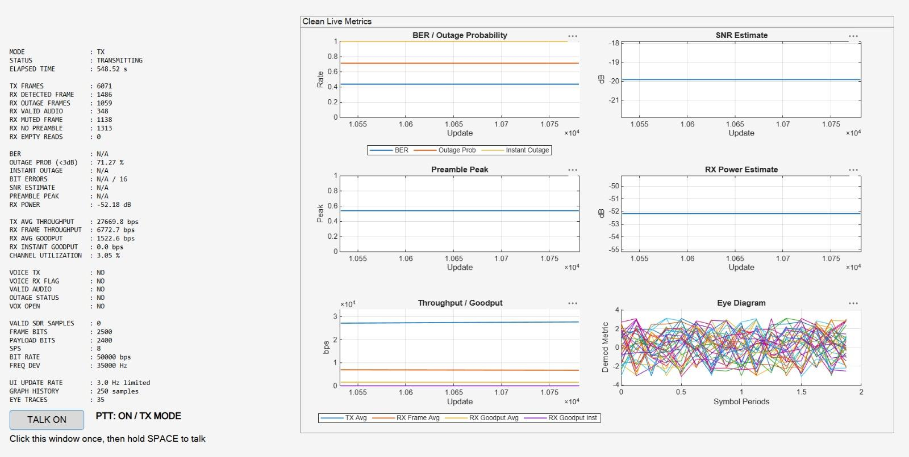
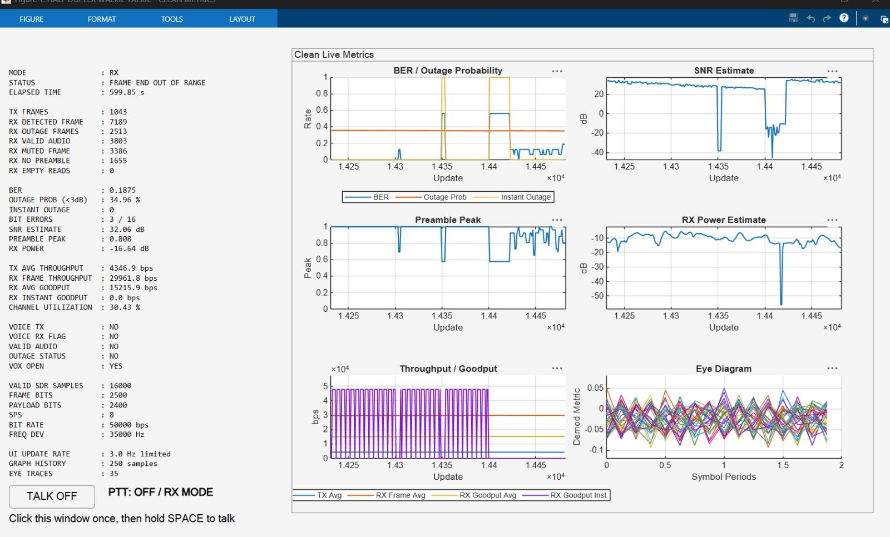
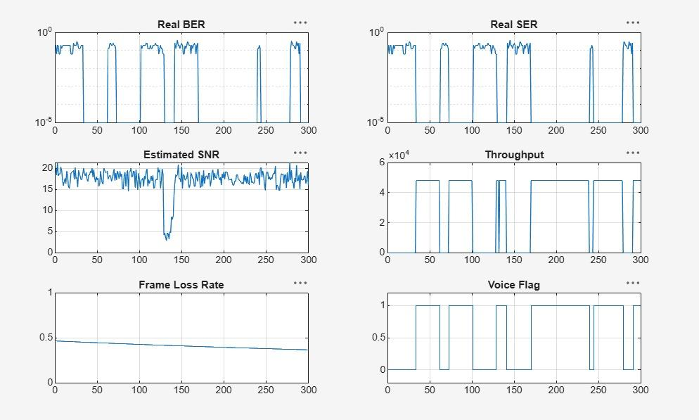
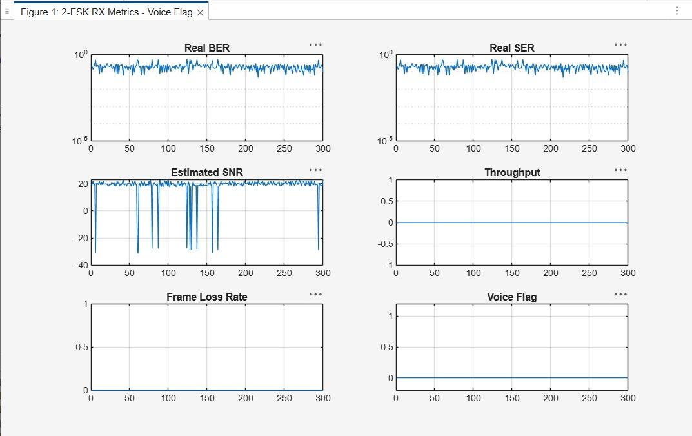
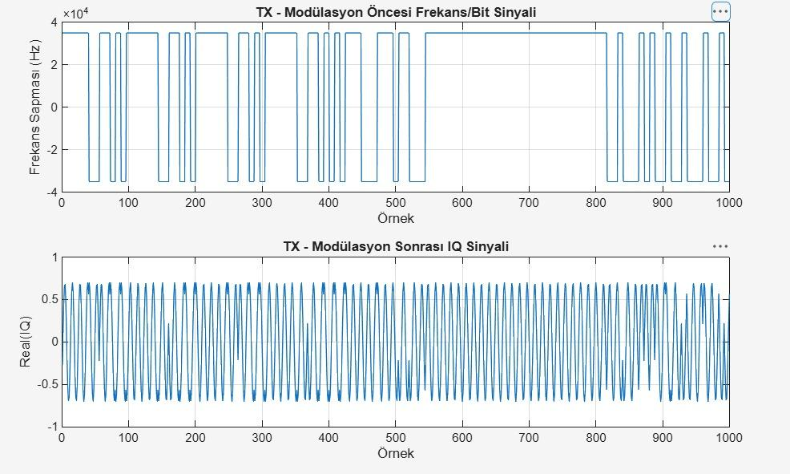
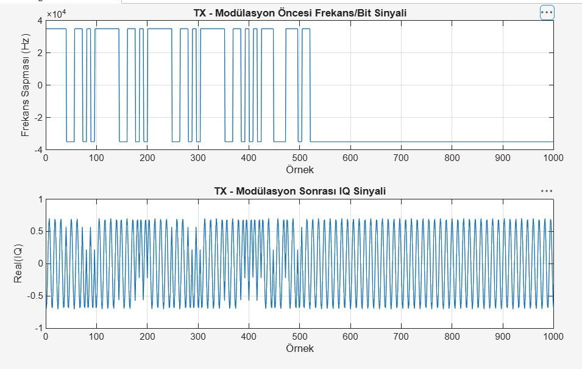
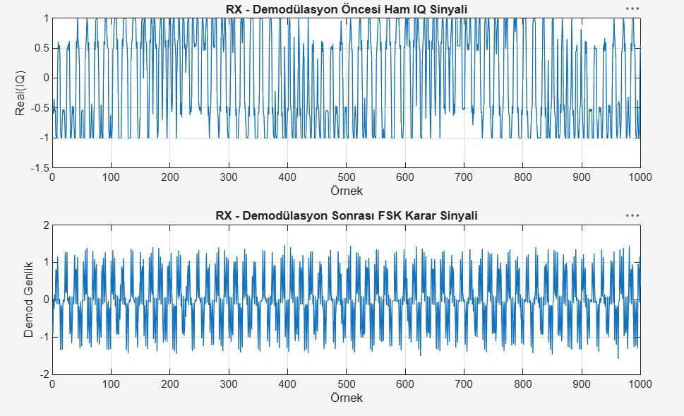
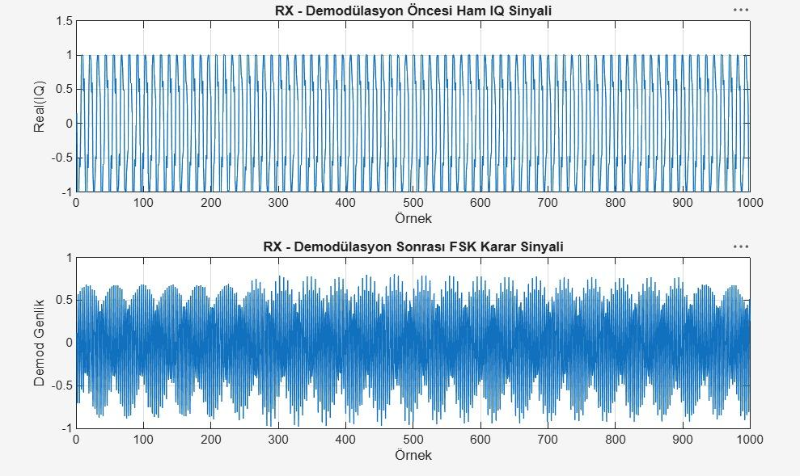

# Digital Wireless Walkie-Talkie | MATLAB & USRP B200

A real-time, **half-duplex digital voice communication system** built in MATLAB using two **Ettus USRP B200** software-defined radios. The system digitizes speech with **Adaptive Delta Modulation (ADM)**, transmits structured frames using **continuous-phase 2-FSK (CPFSK)** at **2.45 GHz**, and reconstructs received audio while monitoring wireless-link quality.

This project was developed and experimentally evaluated for the **EHM3152 Communication Laboratory** at Yildiz Technical University.

## System Overview



**Transmitter:** Microphone → PTT / VOX → ADM encoder → frame construction → CPFSK modulator → USRP B200

**Receiver:** USRP B200 → non-coherent FSK demodulator → Barker synchronization → frame validation → ADM decoder → speaker

### Key Features

- **Half-duplex push-to-talk (PTT):** Hold **Space** or use the **TALK ON / TALK OFF** button to switch between transmitting and listening.
- **Voice activity detection (VOX):** Uses audio RMS thresholds and a short hang time to distinguish speech from silence.
- **Adaptive Delta Modulation:** Encodes speech as a one-bit stream with an adaptive step size.
- **Continuous-phase 2-FSK:** Maps bits to **±35 kHz** frequency deviations without resetting phase at symbol boundaries.
- **Non-coherent reception:** Recovers the FSK decision metric from consecutive complex IQ-sample phase differences.
- **Frame synchronization:** Uses four repetitions of the **Barker-13** sequence and searches across eight symbol-timing offsets.
- **Audio validation and hard mute:** Rejects frames that do not pass preamble, test-bit BER, estimated SNR, and voice-flag checks.
- **Live measurements:** Displays BER, SNR estimate, outage probability, preamble correlation, received power estimate, throughput, goodput, and an eye diagram.

## Hardware and Signal Parameters

| Parameter | Configuration |
| --- | --- |
| SDR hardware | 2 × Ettus USRP B200 (one at each endpoint) |
| Operating mode | Half-duplex, PTT-controlled |
| RF carrier | 2.45 GHz |
| SDR baseband sample rate | 400 kS/s |
| SDR master clock | 20 MHz |
| Interpolation / decimation | 50 / 50 |
| Modulation | Binary continuous-phase FSK (2-FSK / CPFSK) |
| Frequency deviation | ±35 kHz |
| Digital bit rate | 50 kbps |
| Samples per symbol | 8 |
| Audio sampling rate | 8 kHz |
| Frame duration | 50 ms |
| Total frame size | 2,500 bits |
| Encoded voice payload | 2,400 bits |
| TX / RX gain (laboratory settings) | 70 dB / 60 dB |

### Packet Format

Every 50 ms frame consists of the following fields:

```text
|       52 bits        |   16 bits   |    32 bits    |        2,400 bits        |
+----------------------+-------------+---------------+--------------------------+
| Barker-13 preamble   | Known test  | Repeated      | Adaptive Delta Modulated |
| (repeated 4 times)   | sequence    | voice flag    | audio payload            |
+----------------------+-------------+---------------+--------------------------+
                    Total: 2,500 bits at 50 kbps
```

The preamble locates the frame boundary; the known test sequence provides per-frame BER and SNR diagnostics; and the repeated voice flag indicates whether the payload contains active speech.

## Implementation Details

**Transmitting:** The program reads a 50 ms microphone frame, applies RMS-based VOX detection, resamples active speech to the 2,400-bit ADM payload length, builds the frame, and creates a complex CPFSK IQ waveform by integrating the instantaneous frequency deviations.

**Receiving:** The SDR samples are DC-corrected and passed through a phase-difference discriminator. The receiver searches the possible sample offsets and bit polarities for the strongest Barker correlation, then extracts the test bits, voice flag, and payload. Only valid audio frames reach the ADM decoder and audio output filters; rejected or silent frames are muted.

**Validation thresholds in the MATLAB implementation:**

| Check | Acceptance criterion |
| --- | --- |
| Normalized Barker preamble peak | ≥ 0.55 |
| BER across 16 known test bits | ≤ 0.15 |
| Estimated SNR | ≥ 3 dB |
| Voice-flag decision | More than 75% of the 32 flag bits indicate voice |

## Experimental Results

The following results were recorded during **over-the-air laboratory testing** with USRP B200 devices. They illustrate representative operating conditions, rather than guaranteed performance at every distance or in every RF environment.

| Scenario | Observed result | Interpretation |
| --- | --- | --- |
| **Valid voice reception (RX)** | BER **0.0000** (0/16 test-bit errors), estimated SNR **~30 dB**, preamble peak **1.000** | Successful frame synchronization and voice reconstruction |
| **PTT enabled, VOX closed (TX)** | `Voice TX = NO`, `VOX OPEN = NO` | Transmit mode is active, but the frame is marked as containing no valid speech |
| **Invalid/incomplete reception (RX)** | `FRAME END OUT OF RANGE`, `Valid Audio = NO`, instantaneous RX goodput **0 bps** | The receiver rejects the incomplete frame instead of playing corrupted audio |

### 1. Successful Voice Reception



The receiver is in **RX mode** with `STATUS = VALID AUDIO`. The captured measurement shows **0 errors among the 16 known test bits**, a **~30 dB decision-metric SNR estimate**, and a **1.000 normalized Barker correlation peak**. The eye diagram shows two well-separated decision levels.

Instantaneous *valid payload* goodput reaches **48 kbps** (`2,400 bits / 0.05 s`), while the screenshot's average received goodput is about **24.95 kbps** over the elapsed observation period. The latter includes periods without valid voice delivery.

### 2. PTT Enabled, No Speech Detected



The interface shows **PTT ON / TX mode**, but both `Voice TX` and `VOX OPEN` are **NO**. The VOX logic prevents microphone silence from being labeled as valid speech. **Note:** The current implementation can still transmit a structured frame containing a zero-valued audio payload; VOX does not automatically disable RF transmission.

### 3. Rejected / Incomplete Receiver Frame



Here the receiver reports **`FRAME END OUT OF RANGE`** and **`Valid Audio = NO`**, with **0 bps instantaneous valid-audio goodput**. The panel also displays **BER = 0.1875** (3/16 test bits) and an estimated SNR near **32 dB**. A BER of 0.1875 exceeds the configured threshold of 0.15; however, the displayed `FRAME END OUT OF RANGE` status itself indicates an incomplete extracted frame. Some metrics shown in this state can reflect the most recent completed calculations rather than a newly accepted frame.

This illustrates why a high SNR estimate alone is insufficient: frame completeness, synchronization, error checks, and the voice flag must also be satisfactory before audio playback.

### 4. Real-Time Diagnostic Plots

The final report also contains earlier diagnostic plots that track **BER/SER, SNR, throughput, frame loss, and voice flags** over time. These are supporting test captures; the current MATLAB script's main live dashboard instead emphasizes BER/outage, SNR, preamble peak, received power, throughput/goodput, and the eye diagram.

**Speech-active interval** — throughput and the voice flag respond to speech activity; estimated SNR is mostly around **15–20 dB** in this particular capture.



**Silent interval** — the voice flag and useful audio throughput remain inactive, so the output is muted even when signal-quality estimates fluctuate.



<details>
<summary><strong>Additional transmitter and receiver signal analysis plots</strong></summary>

**Transmitter — active voice:** The frequency deviation switches between +35 kHz and −35 kHz, while the generated complex IQ waveform remains continuous in phase.



**Transmitter — silence / low activity:** The deviation sequence shows a different bit-pattern distribution during an inactive voice interval.



**Receiver — active signal:** The upper trace shows the received raw IQ signal and the lower trace shows the phase-difference FSK decision metric used for bit decisions.



**Receiver — no valid voice:** The raw IQ and decision metric remain observable, but the validation logic prevents an invalid or silent frame from producing audio output.



</details>

### How to Interpret the Measurements

- **BER** is calculated using only the **16 known test bits in each detected frame**. A displayed BER of zero means there were no errors in those 16 bits at that instant; it is **not** a measured long-term BER or a proof of error-free voice payloads.
- **SNR** is an estimate derived from the separation and variance of the FSK decision-metric clusters. It should not be treated as a calibrated RF power or spectrum-analyzer measurement.
- **Preamble peak** is a normalized correlation score used for frame synchronization; a peak of **1.000** indicates a strong match in the observed frame.
- **Throughput** counts framed data, whereas **goodput** counts only audio payload bits from valid frames. Average goodput is affected by both voice activity and rejected frames.
- The measurements were taken at **laboratory distances**. Maximum communication range and a statistical BER-versus-SNR characterization were **not** established in the report.

## Requirements

- MATLAB (the existing project documentation lists **R2026a** as the development version)
- **Communications Toolbox** and **Communications Toolbox Support Package for USRP Radio**
- **Audio Toolbox**
- **Signal Processing Toolbox** (for `butter`, `resample`, and filtering operations)
- Two configured **USRP B200** SDR devices, suitable antennas, and USB 3.0 host connections
- Microphone and speaker / headset on each participating computer

## Running the Project

1. Connect the USRP B200 to its host computer, verify that MATLAB recognizes it, and ensure that the 2.45 GHz RF path is configured appropriately.
2. Open [`DigitalWalkieTalkie.m`](DigitalWalkieTalkie.m) in MATLAB. **The script is in the repository root, not in `src/`.**
3. Update the `serialStr` setting near the beginning of the script to match the **locally connected USRP**. Configure the corresponding serial number on the second host as well.
4. Run `DigitalWalkieTalkie.m` on each participating endpoint, with both radios configured to compatible frequency and modem parameters.
5. Click the MATLAB live-metrics figure to give it keyboard focus. **Hold Space to transmit** and speak; **release Space to listen**. The **TALK ON / TALK OFF** button provides an alternative PTT control.
6. Observe the RX/TX state, validity flags, BER, SNR estimate, synchronization peak, goodput, and eye diagram on the dashboard.

```matlab
run('DigitalWalkieTalkie.m')
```

> **Hardware note:** The code contains a hardware-specific USRP serial number and gain settings from the original laboratory setup. Adapt these values before running it on different hardware. This is an over-the-air SDR project, not a software-only MATLAB simulation.

## Repository Structure

```text
.
├── DigitalWalkieTalkie.m            # Main MATLAB TX/RX application
├── README.md                        # Project documentation
└── images/
    ├── block_diagram.png            # Existing transmitter/receiver architecture
    └── results/                    # Screenshots extracted from the final report
        ├── rx-valid-audio.jpg
        ├── tx-vox-closed.jpg
        ├── rx-invalid-frame.jpg
        ├── metrics-active-speech.jpg
        ├── metrics-silence.jpg
        ├── tx-frequency-iq-speech.jpg
        ├── tx-frequency-iq-silence.jpg
        ├── rx-demod-active.jpg
        └── rx-demod-silence.jpg
```

## Limitations and Future Work

- **Error correction:** Add FEC (e.g., Hamming or convolutional coding) to improve resilience to bit errors.
- **Measurement depth:** Extend the BER test sequence, track packet error rate, and run controlled BER-versus-SNR simulations.
- **Link characterization:** Measure usable communication range at different distances, antenna orientations, and channel conditions.
- **Synchronization:** Improve timing recovery and carrier-frequency-offset handling to reduce incomplete-frame cases.
- **Audio quality:** Explore adaptive gain, improved filtering, and speech enhancement.
- **Medium access:** Add automatic TX/RX coordination and collision avoidance for more complete bidirectional operation.

## Academic Context

Developed as a team project for **EHM3152 — Communication Laboratory**, **Department of Electronics and Communications Engineering, Yildiz Technical University**. The experimental figures and values in this README are drawn from the team's *Digital Wireless Walkie-Talkie Final Report* (29 May 2026).

**Project team:** Gökhan Taylan, M. Salih Burulday, M. Talha Yazıcı, and Samet Demircioğlu.
